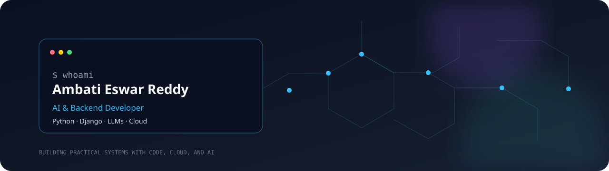
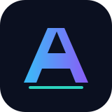
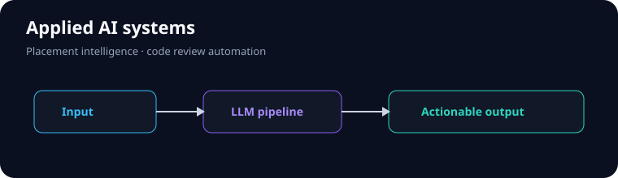
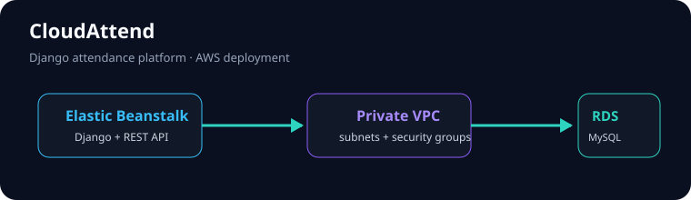
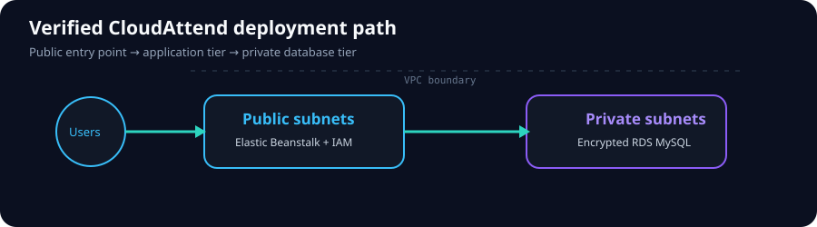
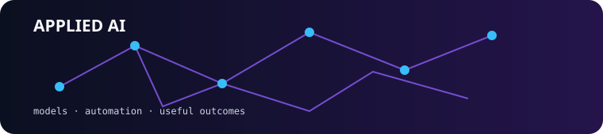
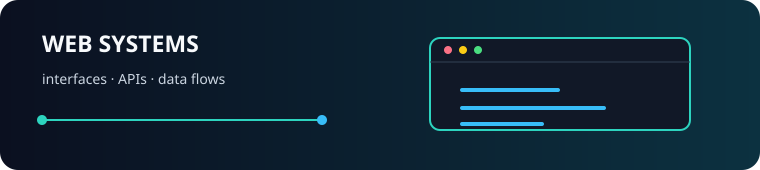
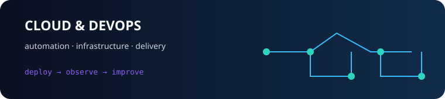
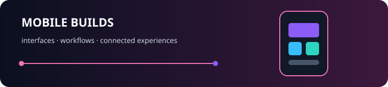

  
   
  

  
  
  
  

 

  <strong>Software Developer · AI & Backend Developer · Python, Django, and LLMs</strong> 
  Building practical systems where reliable backend engineering meets applied AI and cloud deployment.

  <a href="#focus">Focus</a> ·
  <a href="#selected-work">Selected work</a> ·
  <a href="#cloud-engineering">Cloud engineering</a> ·
  <a href="#education--recognition">Education & recognition</a> ·
  <a href="#contact">Contact</a>

## Focus

I am a B.Tech Information Technology student at **Bapatla Engineering College** and an aspiring AI and backend developer. I build with **Python, Django, Flask, REST APIs, MongoDB, Generative AI, and LLMs**, with an emphasis on clean application structure, useful automation, and maintainable delivery.

| Backend | Applied AI | Cloud & engineering |
| --- | --- | --- |
| Django · DRF · Flask · REST APIs · JSON · Django ORM | LLMs · Generative AI · prompt engineering · Mistral AI · Llama · Groq API | AWS Elastic Beanstalk · RDS MySQL · CloudFormation · VPC · IAM · GitHub Actions |

  

## GitHub dashboard

  
  

  

Statistics are generated by third-party services and may be cached or temporarily unavailable. The profile remains useful without them.

## Selected work

<table>
<tr>
<td width="50%" valign="top">

<h3><a href="https://github.com/ambatieswar/PLACEMENT-AI">PlacementAI</a></h3>

Placement intelligence platform using Flask, MongoDB, Mistral AI, and JWT.

<ul>
<li>Nine integrated AI modules, including prediction, skill-gap analysis, interviews, and ATS scoring.</li>
<li>Reported 91.4% prediction accuracy and 500+ student records.</li>
<li>1st Prize at the Ratan Tata SPARK Innovation Hub; ICSIE 2026 publication.</li>
</ul>
<a href="https://github.com/ambatieswar/PLACEMENT-AI">Source code →</a>
</td>
<td width="50%" valign="top">

<h3><a href="https://github.com/ambatieswar/CODE-REFINE">Code-Refine AI</a></h3>

AI-assisted code review and developer productivity platform.

<ul>
<li>Bug detection, complexity analysis, optimization, and refactoring suggestions.</li>
<li>Groq API and LLM-based analysis across 5+ programming languages.</li>
<li>Winner of the AI Innovation Hackathon 2026.</li>
</ul>
<a href="https://github.com/ambatieswar/CODE-REFINE">Source code →</a>
</td>
</tr>
<tr>
<td colspan="2" valign="top">

<h3><a href="https://github.com/ambatieswar/CLOUD-BASED-ATTENDANCE-SYSTEM-">CloudAttend — Cloud Attendance System</a></h3>

Django attendance platform with role-based portals, bulk marking, analytics, reports, student accounts, welcome emails, and a paginated REST API.

<strong>Verified stack:</strong> Django 5 · Django REST Framework · RDS MySQL · Elastic Beanstalk · VPC · CloudFormation · GitHub Actions

<a href="https://github.com/ambatieswar/CLOUD-BASED-ATTENDANCE-SYSTEM-">Source code →</a> · <a href="http://cloudattend.duckdns.org/accounts/login/">Live demo →</a>
</td>
</tr>
</table>

## Cloud engineering

The CloudAttend deployment template provisions a VPC with public subnets for the Elastic Beanstalk application and private subnets for encrypted, non-public RDS MySQL. Security groups restrict database access to the application tier. The repository also includes a manually triggered GitHub Actions workflow for infrastructure and application deployment.

## Experience

### Django Framework Intern — APSSDC

**Remote · May 2025 – July 2025**

- Built a modular Django application with CRUD workflows, authentication, and role-based access across four user roles.
- Designed and optimized **15+ RESTful API endpoints** with Django REST Framework.
- Improved average response latency by approximately **30%** through query optimization.

## Education & recognition

**B.Tech in Information Technology** · Bapatla Engineering College, Andhra Pradesh 
**2023–2027 · CGPA 9.6/10 · CS/IT department topper for three consecutive years**

- IEEE publication: “Placement Intelligence Platform Using AI”, accepted at ICSIE 2026.
- Oracle Cloud Infrastructure (2025), Google Generative AI (2026), Python Essentials — Cisco (2025), Django — APSSDC (2025), Git — Microsoft (2025).
- Pursuing AWS with AI Global Certification through TalentSprint; completed AI & ML Scholars 2026 through Udacity.
- 150+ LeetCode problems and a 50-day consistency streak.
- Smart India Hackathon 2025 participant.

## Repository gallery

Every public project has a direct card below. The artwork is lightweight, GitHub-safe category artwork rather than a fabricated product screenshot; repository links and descriptions are the source of truth.

### Applied AI & data

<table>
<tr>
<td width="50%" valign="top">

<h3><a href="https://github.com/ambatieswar/ML">ML</a></h3>

Machine-learning study and experimentation repository.

<a href="https://github.com/ambatieswar/ML">Open repository →</a>
</td>
<td width="50%" valign="top">

<h3><a href="https://github.com/ambatieswar/IIOT">IIOT</a></h3>

Intelligent and connected systems project repository.

<a href="https://github.com/ambatieswar/IIOT">Open repository →</a>
</td>
</tr>
<tr>
<td width="50%" valign="top">

<h3><a href="https://github.com/ambatieswar/CODE-REFINE">CODE-REFINE</a></h3>

AI-assisted code review and developer productivity platform.

<a href="https://github.com/ambatieswar/CODE-REFINE">Open repository →</a>
</td>
<td width="50%" valign="top">

<h3><a href="https://github.com/ambatieswar/PLACEMENT-AI">PLACEMENT-AI</a></h3>

Placement intelligence platform with AI modules, Flask, MongoDB, and JWT.

<a href="https://github.com/ambatieswar/PLACEMENT-AI">Open repository →</a>
</td>
</tr>
</table>

### Web applications

<table>
<tr>
<td width="50%" valign="top">

<h3><a href="https://github.com/ambatieswar/CHAT-APPLICATION">CHAT-APPLICATION</a></h3>

Django and Channels real-time chat application with authenticated one-to-one messaging and WebSockets.

<a href="https://github.com/ambatieswar/CHAT-APPLICATION">Open repository →</a>
</td>
<td width="50%" valign="top">

<h3><a href="https://github.com/ambatieswar/Eswar-Bazaar">Eswar-Bazaar</a></h3>

Online grocery application project for browsing everyday products and essentials.

<a href="https://github.com/ambatieswar/Eswar-Bazaar">Open repository →</a>
</td>
</tr>
<tr>
<td width="50%" valign="top">

<h3><a href="https://github.com/ambatieswar/College-Attendance">College-Attendance</a></h3>

College attendance project repository.

<a href="https://github.com/ambatieswar/College-Attendance">Open repository →</a>
</td>
<td width="50%" valign="top">

<h3><a href="https://github.com/ambatieswar/FRONTEND-PROJECT">FRONTEND-PROJECT</a></h3>

Colorful HTML, CSS, and JavaScript to-do application with local storage.

<a href="https://github.com/ambatieswar/FRONTEND-PROJECT">Open repository →</a>
</td>
</tr>
<tr>
<td width="50%" valign="top">

<h3><a href="https://github.com/ambatieswar/FULLSTACK">FULLSTACK</a></h3>

Full-stack web development project repository.

<a href="https://github.com/ambatieswar/FULLSTACK">Open repository →</a>
</td>
<td width="50%" valign="top">

<h3><a href="https://github.com/ambatieswar/personal-portfolio">personal-portfolio</a></h3>

Personal portfolio website project.

<a href="https://github.com/ambatieswar/personal-portfolio">Open repository →</a>
</td>
</tr>
<tr>
<td width="50%" valign="top">

<h3><a href="https://github.com/ambatieswar/RESUME-FORGE">RESUME-FORGE</a></h3>

Resume builder project.

<a href="https://github.com/ambatieswar/RESUME-FORGE">Open repository →</a>
</td>
<td width="50%" valign="top">

<h3><a href="https://github.com/ambatieswar/ambatieswar">ambatieswar</a></h3>

This profile repository: visual developer portfolio, project gallery, and verified career snapshot.

<a href="https://github.com/ambatieswar/ambatieswar">Open repository →</a>
</td>
</tr>
</table>

### Cloud, DevOps & Java

<table>
<tr>
<td width="50%" valign="top">

<h3><a href="https://github.com/ambatieswar/SERVERLESS-VOTING-SYSTEM">SERVERLESS-VOTING-SYSTEM</a></h3>

Serverless voting system project.

<a href="https://github.com/ambatieswar/SERVERLESS-VOTING-SYSTEM">Open repository →</a>
</td>
<td width="50%" valign="top">

<h3><a href="https://github.com/ambatieswar/DEVOPS-LAB">DEVOPS-LAB</a></h3>

DevOps laboratory and practical learning repository.

<a href="https://github.com/ambatieswar/DEVOPS-LAB">Open repository →</a>
</td>
</tr>
<tr>
<td width="50%" valign="top">

<h3><a href="https://github.com/ambatieswar/jenkins-cicd-demo">jenkins-cicd-demo</a></h3>

Jenkins continuous integration and delivery learning project.

<a href="https://github.com/ambatieswar/jenkins-cicd-demo">Open repository →</a>
</td>
<td width="50%" valign="top">

<h3><a href="https://github.com/ambatieswar/student-maven-demo">student-maven-demo</a></h3>

Java and Maven demonstration project.

<a href="https://github.com/ambatieswar/student-maven-demo">Open repository →</a>
</td>
</tr>
<tr>
<td width="50%" valign="top">

<h3><a href="https://github.com/ambatieswar/EXPERIMENT-1">EXPERIMENT-1</a></h3>

Technical experiment repository.

<a href="https://github.com/ambatieswar/EXPERIMENT-1">Open repository →</a>
</td>
<td width="50%" valign="top">

<h3><a href="https://github.com/ambatieswar/EXPERIMENT-2-DEVOPS-">EXPERIMENT-2-DEVOPS-</a></h3>

DevOps experiment repository.

<a href="https://github.com/ambatieswar/EXPERIMENT-2-DEVOPS-">Open repository →</a>
</td>
</tr>
<tr>
<td width="50%" valign="top">

<h3><a href="https://github.com/ambatieswar/EXPERIMENT-3">EXPERIMENT-3</a></h3>

Technical experiment repository.

<a href="https://github.com/ambatieswar/EXPERIMENT-3">Open repository →</a>
</td>
<td width="50%" valign="top">

<h3><a href="https://github.com/ambatieswar/CLOUD-BASED-ATTENDANCE-SYSTEM-">CLOUD-BASED-ATTENDANCE-SYSTEM-</a></h3>

Django attendance system with AWS deployment, REST APIs, analytics, and role-based portals.

<a href="https://github.com/ambatieswar/CLOUD-BASED-ATTENDANCE-SYSTEM-">Open repository →</a>
</td>
</tr>
</table>

### Mobile

<table>
<tr>
<td width="50%" valign="top">

<h3><a href="https://github.com/ambatieswar/ANEMAI-DETECTION-MOBILE-APP-">ANEMAI-DETECTION-MOBILE-APP-</a></h3>

Dart mobile application project.

<a href="https://github.com/ambatieswar/ANEMAI-DETECTION-MOBILE-APP-">Open repository →</a>
</td>
<td width="50%" valign="top"></td>
</tr>
</table>

## Contact

- Email: [ambatieswarreddy25@gmail.com](mailto:ambatieswarreddy25@gmail.com)
- LinkedIn: [linkedin.com/in/ambatieswar](https://linkedin.com/in/ambatieswar)
- Resume: [Download my resume](https://drive.google.com/file/d/12p3EO1IkpfemCy13mEulSsWYJy21EmNt/view?usp=drivesdk)
- GitHub: [@ambatieswar](https://github.com/ambatieswar)

  Build deliberately. Document clearly. Ship useful software.

